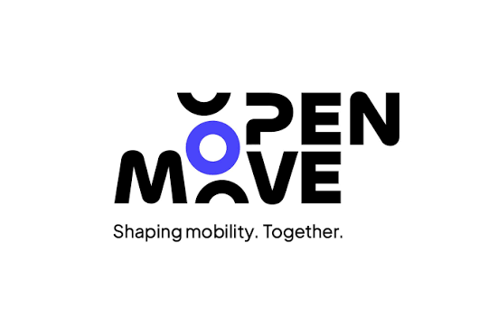

<a id="readme-top"></a>

<!-- PROJECT HEADER -->
<div align="center">
  <a href="https://github.com/openmove">
    
  </a>

  <h3 align="center">{{Service name}}</h3>

  <p align="center">
    {{One sentence: what this service does, which flow or tenant it serves, and who calls it.}}
    <br />
    <a href="https://docs.openmove.com/{{page}}"><strong>Explore the docs on Neuron »</strong></a>
    <br />
    <br />
    <a href="https://github.com/openmove/{{repo}}/issues/new?labels=bug">Report a bug</a>
    &middot;
    <a href="https://github.com/openmove/{{repo}}/issues/new?labels=enhancement">Request a feature</a>
  </p>

  <!-- Replace with the real Actions badge once the workflow exists:
  [](https://github.com/openmove/REPO/actions/workflows/ci.yml)
  -->
  
  
  
</div>

<!-- TABLE OF CONTENTS -->
<details>
  <summary>Table of Contents</summary>
  <ol>
    <li>
      <a href="#about-the-project">About the project</a>
      <ul>
        <li><a href="#flow">Flow</a></li>
        <li><a href="#built-with">Built with</a></li>
      </ul>
    </li>
    <li>
      <a href="#getting-started">Getting started</a>
      <ul>
        <li><a href="#prerequisites">Prerequisites</a></li>
        <li><a href="#installation">Installation</a></li>
        <li><a href="#environment-variables">Environment variables</a></li>
      </ul>
    </li>
    <li><a href="#usage">Usage</a></li>
    <li><a href="#project-structure">Project structure</a></li>
    <li><a href="#tests">Tests</a></li>
    <li><a href="#deployment">Deployment</a></li>
    <li><a href="#operational-notes">Operational notes</a></li>
    <li><a href="#roadmap">Roadmap</a></li>
    <li><a href="#contributing">Contributing</a></li>
    <li><a href="#contacts">Contacts</a></li>
  </ol>
</details>

<!-- ABOUT THE PROJECT -->
## About the project

| | |
|---|---|
| **Owner** | {{team}} — {{contact}} |
| **Status** | In development / Production / Deprecated |
| **Runtime** | {{URL, CronJob, or consumer}} |
| **Environments** | [Staging]({{url}}) · [Production]({{url}}) |

A short paragraph of context. State what this service does **not** do when the boundary is not obvious.

### Flow

1. **Input** — {{API, queue, file, or CronJob}}
2. **Processing** — {{main steps}}
3. **Output** — {{database, Nucleus API, Slack, MQTT}}

Dependencies: Nucleus, Postgres, Mongo, RabbitMQ, or external services.

### Built with

Keep only the badges this repository actually uses. Copy any missing one from the catalog, then delete the catalog before publishing.

* [![Node.js][Node.js]][Node-url]
* [![TypeScript][TypeScript]][TypeScript-url]
* [![Fastify][Fastify]][Fastify-url]
* [![PostgreSQL][PostgreSQL]][PostgreSQL-url]

<details>
  <summary>Badge catalog</summary>

  **Languages and runtimes**

  * [![JavaScript][JavaScript]][JavaScript-url]
  * [![Java][Java]][Java-url]
  * [![Kotlin][Kotlin]][Kotlin-url]
  * [![Go][Go]][Go-url]
  * [![Python][Python]][Python-url]
  * [![Rust][Rust]][Rust-url]
  * [![C++][C++]][C++-url]

  **Frameworks**

  * [![Spring][Spring]][Spring-url]
  * [![Meteor][Meteor]][Meteor-url]
  * [![Nuxt][Nuxt]][Nuxt-url]
  * [![Vue][Vue]][Vue-url]

  **Data and platform**

  * [![MongoDB][MongoDB]][MongoDB-url]
  * [![RabbitMQ][RabbitMQ]][RabbitMQ-url]
  * [![MQTT][MQTT]][MQTT-url]
  * [![Docker][Docker]][Docker-url]
  * [![Kubernetes][Kubernetes]][Kubernetes-url]
  * [![Helm][Helm]][Helm-url]
  * [![Terraform][Terraform]][Terraform-url]
  * [![Google Cloud][Google Cloud]][GoogleCloud-url]
  * [![pnpm][pnpm]][pnpm-url]
  * [![Maven][Maven]][Maven-url]
  * [![Gradle][Gradle]][Gradle-url]

</details>

<p align="right">(<a href="#readme-top">back to top</a>)</p>

<!-- GETTING STARTED -->
## Getting started

### Prerequisites

* {{runtime and version}}
* Docker
* Access to `europe-west4-docker.pkg.dev` and, when needed, `kubectl`
* Secrets from {{Blackbox / Secret Manager}}. Never commit credentials.

### Installation

1. Clone the repository
   ```sh
   git clone git@github.com:openmove/{{repo}}.git
   cd {{repo}}
   ```
2. Install dependencies
   ```sh
   {{install}}
   ```
3. Create your local environment file
   ```sh
   cp .env.example .env
   ```
4. Start the service
   ```sh
   {{run}}
   ```

Locally the service listens on `http://localhost:{{port}}`.

### Environment variables

Real values live in {{Blackbox / a Kubernetes secret}}, never in the repository.

| Variable | Required | Description |
|---|---|---|
| `PG_HOST` | yes | PostgreSQL host |
| `PG_DATABASE` | yes | Database name |
| `MONGO_URL` | yes | Mongo connection string |

<p align="right">(<a href="#readme-top">back to top</a>)</p>

<!-- USAGE -->
## Usage

The most common ways to use the service: example requests, CLI commands, or how to trigger a job.

```sh
curl -X POST http://localhost:{{port}}/{{endpoint}} -H 'Content-Type: application/json' -d '{ }'
```

API reference: {{link to the OpenAPI spec}}.

<p align="right">(<a href="#readme-top">back to top</a>)</p>

<!-- PROJECT STRUCTURE -->
## Project structure

```
src/                      application code
_cluster_configuration/   Kubernetes manifests (_common + _k/{{env}})
.env.example              variables without secrets
```

<p align="right">(<a href="#readme-top">back to top</a>)</p>

<!-- TESTS -->
## Tests

```sh
{{test command}}
```

What the suite covers (unit, integration) and what must be running first (database, queues).

<p align="right">(<a href="#readme-top">back to top</a>)</p>

<!-- DEPLOYMENT -->
## Deployment

### Docker

Image: `europe-west4-docker.pkg.dev/openmove-1475230942894/images/{{name}}:{{tag}}`.

```sh
{{build and push command}}
```

### Kubernetes

Manifests live in `_cluster_configuration/` (`_common` plus an overlay in `_k/{{env}}`).

```sh
kubectl apply -k _cluster_configuration/_k/production
```

Document the namespace, the ingress, and how to roll back.

<p align="right">(<a href="#readme-top">back to top</a>)</p>

<!-- OPERATIONAL NOTES -->
## Operational notes

Known failure modes, what to check in the logs, and links to Neuron or the dashboard.

<p align="right">(<a href="#readme-top">back to top</a>)</p>

<!-- ROADMAP -->
## Roadmap

- [x] {{done feature}}
- [ ] {{next feature}}
- [ ] {{later feature}}
    - [ ] {{sub-task}}

See the [open issues](https://github.com/openmove/{{repo}}/issues) for the full list.

<p align="right">(<a href="#readme-top">back to top</a>)</p>

<!-- CONTRIBUTING -->
## Contributing

1. Branch off `{{develop | master}}`: `git checkout -b feat/{{short-description}}`
2. Commit using [Conventional Commits](https://www.conventionalcommits.org/): `git commit -m "feat(scope): add something"`
3. Push the branch: `git push origin feat/{{short-description}}`
4. Open a pull request and request a review from the owner

See [CONTRIBUTING.md](CONTRIBUTING.md) for details, if present.

<p align="right">(<a href="#readme-top">back to top</a>)</p>

<!-- CONTACTS -->
## Contacts

* **Owner:** {{name}} — {{email or Slack handle}}
* **Team channel:** {{#slack-channel}}
* **Project link:** [github.com/openmove/{{repo}}](https://github.com/openmove/{{repo}})

<p align="right">(<a href="#readme-top">back to top</a>)</p>

<!--
Optional sections — add only when they apply, then delete this comment.

## Migrations
Tool used, and how to create and apply a migration.

## Scheduled jobs
Cron schedule, what each job does, and how to run it by hand.

## Out of scope
Behaviour this repository explicitly does not own.
-->

<!-- MARKDOWN LINKS & IMAGES -->
[Node.js]: https://img.shields.io/badge/Node.js-339933?style=for-the-badge&logo=nodedotjs&logoColor=white
[Node-url]: https://nodejs.org/
[TypeScript]: https://img.shields.io/badge/TypeScript-3178C6?style=for-the-badge&logo=typescript&logoColor=white
[TypeScript-url]: https://www.typescriptlang.org/
[Fastify]: https://img.shields.io/badge/Fastify-000000?style=for-the-badge&logo=fastify&logoColor=white
[Fastify-url]: https://fastify.dev/
[PostgreSQL]: https://img.shields.io/badge/PostgreSQL-4169E1?style=for-the-badge&logo=postgresql&logoColor=white
[PostgreSQL-url]: https://www.postgresql.org/
[MongoDB]: https://img.shields.io/badge/MongoDB-47A248?style=for-the-badge&logo=mongodb&logoColor=white
[MongoDB-url]: https://www.mongodb.com/
[RabbitMQ]: https://img.shields.io/badge/RabbitMQ-FF6600?style=for-the-badge&logo=rabbitmq&logoColor=white
[RabbitMQ-url]: https://www.rabbitmq.com/
[JavaScript]: https://img.shields.io/badge/JavaScript-F7DF1E?style=for-the-badge&logo=javascript&logoColor=black
[JavaScript-url]: https://developer.mozilla.org/en-US/docs/Web/JavaScript
[Java]: https://img.shields.io/badge/Java-007396?style=for-the-badge&logo=openjdk&logoColor=white
[Java-url]: https://openjdk.org/
[Kotlin]: https://img.shields.io/badge/Kotlin-7F52FF?style=for-the-badge&logo=kotlin&logoColor=white
[Kotlin-url]: https://kotlinlang.org/
[Go]: https://img.shields.io/badge/Go-00ADD8?style=for-the-badge&logo=go&logoColor=white
[Go-url]: https://go.dev/
[Python]: https://img.shields.io/badge/Python-3776AB?style=for-the-badge&logo=python&logoColor=white
[Python-url]: https://www.python.org/
[Rust]: https://img.shields.io/badge/Rust-000000?style=for-the-badge&logo=rust&logoColor=white
[Rust-url]: https://www.rust-lang.org/
[C++]: https://img.shields.io/badge/C++-00599C?style=for-the-badge&logo=cplusplus&logoColor=white
[C++-url]: https://isocpp.org/
[Spring]: https://img.shields.io/badge/Spring-6DB33F?style=for-the-badge&logo=spring&logoColor=white
[Spring-url]: https://spring.io/
[Meteor]: https://img.shields.io/badge/Meteor-DE4F4F?style=for-the-badge&logo=meteor&logoColor=white
[Meteor-url]: https://www.meteor.com/
[Nuxt]: https://img.shields.io/badge/Nuxt-00DC82?style=for-the-badge&logo=nuxt&logoColor=white
[Nuxt-url]: https://nuxt.com/
[Vue]: https://img.shields.io/badge/Vue-4FC08D?style=for-the-badge&logo=vuedotjs&logoColor=white
[Vue-url]: https://vuejs.org/
[MQTT]: https://img.shields.io/badge/MQTT-3C5280?style=for-the-badge&logo=mqtt&logoColor=white
[MQTT-url]: https://mqtt.org/
[Docker]: https://img.shields.io/badge/Docker-2496ED?style=for-the-badge&logo=docker&logoColor=white
[Docker-url]: https://www.docker.com/
[Kubernetes]: https://img.shields.io/badge/Kubernetes-326CE5?style=for-the-badge&logo=kubernetes&logoColor=white
[Kubernetes-url]: https://kubernetes.io/
[Helm]: https://img.shields.io/badge/Helm-0F1689?style=for-the-badge&logo=helm&logoColor=white
[Helm-url]: https://helm.sh/
[Terraform]: https://img.shields.io/badge/Terraform-844FBA?style=for-the-badge&logo=terraform&logoColor=white
[Terraform-url]: https://www.terraform.io/
[Google Cloud]: https://img.shields.io/badge/Google_Cloud-4285F4?style=for-the-badge&logo=googlecloud&logoColor=white
[GoogleCloud-url]: https://cloud.google.com/
[pnpm]: https://img.shields.io/badge/pnpm-F69220?style=for-the-badge&logo=pnpm&logoColor=white
[pnpm-url]: https://pnpm.io/
[Maven]: https://img.shields.io/badge/Maven-C71A36?style=for-the-badge&logo=apachemaven&logoColor=white
[Maven-url]: https://maven.apache.org/
[Gradle]: https://img.shields.io/badge/Gradle-02303A?style=for-the-badge&logo=gradle&logoColor=white
[Gradle-url]: https://gradle.org/
